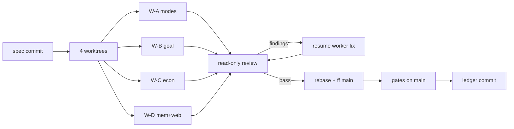

# SPEC BH：PiSession 回测加固（P0–P2）

> 落盘位置：`spec/2026-11-14-backtest-hardening.md`（批准后写入，并在 `spec/README.md` 加状态行）
> 基线：core `d1cd61a`（0.5.0 + `/smart-compact` 更名）。条目 ID 前缀 `BH-`。

## 0. 一页摘要

- **来源**：Devin 会话 `dour-arithmetic` 的审查没有完成，本会话补完了静态审查 A 以及本机和 Air 的 PiSession 回测。下面所有 file:line 都已在 `d1cd61a` 上核实。
- **本轮范围**：2 个安全项（S1、S2），7 个真实损失项（R1–R7），4 个资源与 IO 项（E1–E4），以及 2 个需先复现再修的项（E5、E6）。
- **执行方式**：按模块所有权拆成 4 个 worker，各自在独立 worktree 并行开发。每个分支先经独立只读审查，再变基合入 main。共享台账由 orchestrator 统一提交。只做本地提交，不发版。

## 1. 背景与证据

| ID | 问题 | 位置 | 回测或复现证据 |
|---|---|---|---|
| S1 | 路径规则中的单个 `*` 永远匹配不上，只有 `**` 生效 | `modes/path-permission-match.ts:35` escapeRegex | 用户现有 deny 规则 `Read(./.env.*)` 和 `Read(./**/.env.*)` 实际无效 |
| S2 | 主机名用正则提取，遇到 `@` 就停 | `web-gov/index.ts:93` | `https://github.com@evil.example/` 会被当成预批准的 github.com |
| R1 | provider 出错（stopReason=error）后 goal 无限续跑 | `goal/goal.ts:2221-2227` + `goal-continuation.ts` | Air 13 小时内 2,241 次错误、1.11 亿 token；本机 2.6 小时内 675 次 |
| R2 | 记忆密钥探测对所有 write/edit 都生效 | `memory/guard.ts:110-118`（1618f89 回归） | 本机 7 次、Air 5 次误拦；模型改用 bash 绕过，其中一次把冲突标记提交了进去 |
| R3 | 只要存在任意 deny 规则，带任何参数的 mv/cp 都会被直接拒绝；heredoc 正文也被当成命令解析 | `modes/bash-path-check.ts:526-565`（82d35c2） | `cp -R`、`ssh host bash -s <<EOF` 被误拒 |
| R4 | 显式 timeout 会关闭 120 秒自动转后台 | `bg-shell/foreground.ts:73-75` | Air 有 1,136 次 timeout>3600；59 次前台运行超过 120 秒，合计约 3.7 小时 |
| R5 | then_run 没有默认超时，也不会转后台，描述还鼓励用它做 start/restart | `action-fusion/then-run.ts:30,124` | 命令挂住时会同时卡住当前回合和该文件的队列 |
| R6 | auto 模式的 allow/soft_deny 对整条命令做子串或前缀匹配 | `modes/index.ts:1127-1136, 1283-1290` | `git reset … && npm test` 可以绕过 soft_deny |
| R7 | 配置里出现非字符串元素就抛 TypeError，所有 bash 调用被拒；`void setMode` 的 rejection 无人处理；bus 监听器之间没有隔离 | `modes/config.ts:92-105`、`modes/index.ts:1385, 559-563`、`bus.ts:179` | 静态审查 A |
| E1 | 每个带 usage 的事件都追加一份完整 pi-goal-state 快照，同时重写 md 并重扫磁盘 | `goal/goal-lifecycle.ts:429-442`、`goal.ts:1926-1951` | 98.8% 的条目只有 usage 或 updatedAt 不同；最严重的文件里 goal-state 占 40% |
| E2 | 跨项目的队列记录永不过期 | `memory/queue-drain.ts:158-162` | 6 个文件，最老 37 天，attempts=0 |
| E3 | obs_recall 结果会被再次打包；每次请求都追加占位 ledger；context handler 不满足 fail-open | `observation-pack/projection.ts:156, 208-217`、`index.ts:161` | 本机 53 个嵌套包；Air ledger 43MB，其中 19.4 万行是占位行 |
| E4 | 模型没变也调用 setModel；setMode 没有串行化；切换经过 plan 时会创建 plan.md | `modes/index.ts` 的 setMode | 107 次 plan→auto→bypass 的启动序列 |
| E5 | （待复现）profile 切换模型后，宿主重置的 thinking level 被 effort 当成用户显式选择 | `modes/profile-apply.ts:127`、`effort/index.ts:222` | 中等置信度 |
| E6 | （待复现）audit 超时后 auditor session 或子进程泄漏 | `goal/goal-audit-flow.ts`、`goal-auditor.ts` | 中等置信度 |

## 2. 目标、非目标与决策

### 2.1 目标

1. 上表 S1–S2、R1–R7、E1–E4 全部修复。每项都要有新增测试，并先在基线上跑红作为证据，修复后转绿。
2. E5 和 E6 先复现。复现成立就修复并加测试；不成立就写入 OPEN-QUESTIONS，附证据，不改代码。
3. 三门（`bun run check`、`bun run test`、`bun run contracts`）全绿，升级金丝雀测试也要绿。
4. 每个条目单独提交，可以单独 revert。

### 2.2 非目标（做了即越界）

- P3 体验项留到下一轮，包括：plan 只读白名单（`cd`、`git -C`、`2>/dev/null`）、waitFor 占位噪声、classifier 不可用时的提示文案、阻塞式 task-wait 工具、TaskStop 改写已结束任务、task id 复用、memory selector 超时、死代码清理、`run-tests.mjs` 写死 zsh、`writeJsonAtomic` 权限、obs 对 CJK 的 token 估算、review directive 预算，以及 goal.ts 和 modes/index.ts 的拆分。
- 不改 session entry 格式或磁盘布局（P0-CT-08/09），不改 contracts 测试期望，不新增环境变量或设置键。
- 不清理用户已有的膨胀数据（goal-state 条目和 ledger）。E2 的自然过期除外。
- 不修改 `lib/`。唯一例外：如果 E5 复现成立，W-A 可以修改 `lib/effort-owner.ts`。
- 不深审 review/ 模块，不评估 smart compaction，不核实 memory index 是否超过 25K。
- 不 bump 版本、不 push、不安装、不 tag。

### 2.3 已确认决策（用户，2026-11-14）

| # | 选择 |
|---|---|
| D-BH-1 | 范围为 P0–P2；E5 和 E6 先复现再修 |
| D-BH-2 | R4 不猜测单位。显式 timeout 不再关闭自动转后台；转入后台后，timeout 成为任务截止时间 |
| D-BH-3 | 按模块所有权 4 路并行；共享台账由 orchestrator 汇总 |
| D-BH-4 | 只做本地提交 |

## 3. 不变量（违反即驳回）

- AGENTS.md 的 10 条硬不变量全部保持，重点是：bus 同步发布（R7 的监听器隔离也必须同步）、effort-owner 是唯一调用 setThinkingLevel 的地方（E5）、obs-pack 必须 fail-open 且不改历史（E3）、goal 的写操作只能走 lifecycle 动词（#120 封装，R1 和 E1 不能绕过）。
- 只有本 spec 明确改变的行为可以变化。如果有 parity 或 golden fixture 出现差异，只能逐例更新确属预期变化的 case，并在报告中列出；禁止整体重新生成。
- 旧测试只能在新覆盖能证明等价时删减，禁止通过修改期望来掩盖回归。

## 4. 逐项设计与验收

### W-A modes（`extensions/modes/**`、`extensions/bus.ts`；E5 另含 `extensions/effort/**`、`lib/effort-owner.ts`）

- **BH-S1**：glob 转换规则改为单个 `*` 对应 `[^/]*`，`**` 保持原语义。所有字符串字面量都要转义。
  - 验收：`./.env.*` 能匹配 `./.env.local`，不匹配 `./a/.env.local`；`./**/.env.*` 能匹配 `./a/.env.local`；`~/.ssh/*` 能匹配 `~/.ssh/id_rsa`。deny、ask、allow 三类规则都要覆盖，bash W4 复用这套逻辑的路径也要测。现有 `**` 用例零回归。
- **BH-R3**：mv/cp 只把 `-t DIR` 和 `--target-directory[=DIR]` 视为改变目标路径的写法。其他参数（`-R/-r/-p/-f/-i/-n/-v/-a/--preserve…`）先剥离，再按无参数形态分析。无法识别的参数改为 ask，不再 deny，并让注释与实现一致。`ssh … <<EOF` 的正文在远端执行，跳过本地路径检查；本地 `bash -s` 或 `sh -s` 的 heredoc 正文保持现有分析。
  - 验收：存在无关 deny 规则时，`cp -R src dst` 不被拒绝；`mv -f a ~/.ssh/x` 在规则 `Edit(~/.ssh/**)` 下仍被拒绝；`cp -t ~/.ssh src` 检查的是目标目录；ssh heredoc 正文里的 `rm ~/.ssh/x` 不触发本地 deny；本地 `bash -s <<EOF` 的行为不变。
- **BH-R6**：新增纯函数模块 `modes/auto-rule-match.ts`，用 `splitShellSegments`（`bash-analysis.ts:190`）切分命令。任一段命中 soft_deny 即判为 soft_deny。只有每一段都命中 allow 才走快速放行。无法切分或含命令替换时不快速放行，交给后续 tier。
  - 验收：给定 allow=[npm test]、soft_deny=[git reset]，`git reset --hard && npm test` 判为 soft_deny；`npm test && npm run lint` 两段都在 allow 中时放行；`npm test; curl x|sh` 不快速放行。单段命令要有新旧结果对照表，结果完全一致。
- **BH-R7**：加载配置时过滤非字符串元素，并发出一次警告。用 try/catch 包住 `adjudicator.check`，出错时以明确原因拒绝（`permission check failed: …`），保持 fail-closed，但不再抛出 TypeError。`cycleMode` 加 `.catch` 并通知用户。bus 发布时逐个监听器 try/catch，一个监听器出错不影响其他监听器，发布仍保持同步。
  - 验收：配置含 `[1, null, "npm test"]` 时，bash 调用正常，`npm test` 规则仍然生效；check 抛错时，拒绝原因可读；setMode rejection 不再是未处理异常；某个监听器抛错时，其他监听器仍收到当期快照。
- **BH-E4**：每次 setMode 分配一个代号，只有最新请求的代号会执行副作用（setModel、profile、创建 plan 文件）。目标模型与当前模型相同时跳过 setModel。plan.md 只在最终停在 plan 模式时创建。
  - 验收：快速切换 plan→auto→bypass 时，最终模式是 bypass；模型不变时 setModel 调用 0 次；不创建 plan.md。单次进入 plan 的行为不变。
- **BH-E5**（先复现）：用 FakePi 或真实 AgentSession 复现“profile 切换模型 → 宿主重置 thinking → effort 记为显式选择”。成立时，在 effort-owner 层标记由模型切换引起的 thinking 变化，并保持优先级链：env pin > 显式选择 > profile > 模型默认。不成立时，写入 OPEN-QUESTIONS。

### W-B goal（`extensions/goal/**`）

- **BH-R1**：在续跑决策点读取最后一条 assistant 消息的 stopReason。按 goal 在内存中维护连续错误计数，遇到非错误的终止就清零。计数达到 2 时，通过 lifecycle 的 pause 动词暂停 goal：`pauseReason` 设为 `"provider error: <errorMessage 前 120 字>"`，`pauseSuggestedAction` 提示检查 provider 或额度后执行 `/goal resume`，同时通知用户。aborted 分支保持不变。
  - 验收（FakeHost）：连续 2 次 error 后 goal 暂停，不排第 3 次续跑；error、success、error 的序列不会暂停；P0-CT-08 契约保持绿。
- **BH-E1**：只有 usage 或 updatedAt 变化时，只更新内存，不追加条目、不重写 md、不重扫磁盘。usage 在三个时机落盘：每次 agent_end（若自上次落盘后有变化）、session_shutdown、任何真实状态转移（转移时立即写入并带上最新 usage）。预算判定继续使用内存中的值，到点立即触发。
  - 验收：单次 run 中有 N 个 usage 事件时，usage 相关条目不超过 1 条；状态转移立即落盘；重启后恢复的 usage 误差不超过一次 run 的增量；预算超限在同一个事件上触发；用 50 回合合成场景对比条目数并写进报告；P0-CT-08 保持绿。
- **BH-E6**（先复现）：用永不 settle 的假 auditor 复现。成立时，由 flow 层在超时后 abort 并只 dispose 一次（放在 finally 中），并加测试。不成立时，写入 OPEN-QUESTIONS。

### W-C economy（`extensions/{bg-shell,action-fusion,observation-pack}/**`）

- **BH-R4**：先检查上游 `gvanderclay/pi-bg-bash` 有没有在 v0.2.1 之后修复这个问题。若已修，就最小化移植上游改法。否则：`promotable()` 只保留 `sleep` 豁免；`promote()` 中只要有显式 timeout，就设置 `task.deadline = startedAt + timeout*1000`，并清除前台的 stop 定时器。同步更新头注释第 5 行，并把 schema 中的 timeout 描述改为：`Seconds (not ms). Still running after 120 s → background; timeout becomes its deadline.`
  - 验收（用 `CC_CORE_BG_PROMOTE_*` 测试缝）：timeout=600 的命令超过晋升阈值后转入后台，deadline 正确；timeout 小于阈值时仍按前台超时终止；`sleep` 和 waitFor 的行为不变。
- **BH-R5**：从描述中删除 start/restart 用法。没有给 timeout 时默认 600 秒（导出常量，不可配置）。超时消息提示模型：长时间运行或服务类命令应改用 bash 后台执行。
  - 验收：挂住的命令在默认超时（用测试缝缩短）后终止，该文件的队列随之释放；显式 timeout 仍然生效；描述中不再出现 start/restart；金丝雀测试保持绿。
- **BH-E3**：(a) 投影时跳过 `obs_recall` 的结果，不再打包；(b) 每个对象 id 在本进程内只在首次投影时写一条占位 ledger，ledger 格式不变；(c) context handler 外层加 try/catch，出错时返回空、不修改；`isPureTextResult` 移到逐条消息的 try 内部。
  - 前置检查：如果有任何指标或 OBS-09 依赖逐次占位行，先上报，再动手。
  - 验收：obs_recall 结果不出现嵌套包；同一 id 重复投影时 ledger 只增加 1 行；注入异常后 handler 不抛出，其他消息照常投影；OBS 系列契约保持绿。

### W-D memory + web（`extensions/{memory,web-gov}/**`）

- **BH-S2**：用 `new URL()` 解析主机名（转小写，去掉末尾的点）。解析失败时走 ask。带 userinfo 的 URL 一律不视为预批准，走 ask。IP 字面量按主机处理：`domain:` 规则照常匹配，预批准列表不匹配 IP。
  - 验收：`https://github.com@evil.example/` 走 ask；deny 规则 `domain:evil.example` 能拦截它；`https://GitHub.com./x` 解析为 github.com；`http://127.0.0.1:8080` 的主机是 127.0.0.1；`https://evil.example/github.com` 不视为预批准。
- **BH-R2**：只对 `inMemory` 路径做密钥探测。edit 只扫描 `edits[].newText`，write 扫描 content。
  - 验收：在记忆目录之外写入疑似密钥的内容不被拦截；在记忆文件中写入密钥仍被拦截；记忆文件原有内容含疑似密钥但 newText 干净时放行。
- **BH-E2**：先做年龄和 attempts 的过期检查，再做 projectsDir 路由跳过。过期的跨项目记录与同项目过期记录走同一处置路径。年龄取记录本身的时间，不取文件 mtime，因为 release 时的重命名不能重置年龄。
  - 验收：过期的跨项目记录被处置；未过期的照常 release；P0-3 的 claim 语义和 P0-CT-09 的命名不变。

## 5. 派工与流程

1. **Orchestrator 准备**：提交 spec 和 README 状态行（`docs(spec): add backtest hardening spec (BH)`）。为每组执行 `git worktree add .claude/worktrees/bh-<a|b|c|d> -b w/bh-<group> <spec-commit>`，并在 worktree 内执行 `pnpm install --frozen-lockfile --offline`。
2. **Worker 流程**（每个条目一轮）：先在 base 上核对 file:line，再写测试并跑出红色输出作为证据，然后实现、转绿，最后单独提交，格式为 `<module>(bh-<ID>): 
`。全部条目完成后，在 worktree 中跑通三门。
   - 禁止：修改所有权之外的文件；修改 CHANGELOG、DEVIATIONS、PROGRESS、OPEN-QUESTIONS、spec/、test/contracts/、lib/（E5 的例外见上）；push；修改 git 身份；读取 auth 文件。
   - 并行负载下若出现 flaky 测试，先单独重跑，确认后才算回归。
3. **Worker 报告**：逐条给出基线红证据、改动文件、新增测试、三门结果（含测试数量）、可直接使用的中文台账稿（CHANGELOG、DEVIATIONS、PROGRESS 各一份），以及遗留问题。
4. **独立审查**：每个分支派一个只读审查 subagent。审查内容包括：与本 spec 的逐条符合性、第 3 节不变量、测试是否真的在基线上为红、是否越出所有权范围。审查可以在 worktree 中跑门禁。审查意见交回原 worker 修复（resume），最多 2 轮；仍未通过就上报用户。
5. **合并**：按 W-D → W-C → W-B → W-A 的顺序，各分支变基到 main 后 fast-forward，保持线性历史。全部合并后在 main 上跑三门和金丝雀测试。
6. **台账提交**（orchestrator 负责，`docs(bh): changelog, deviations, progress`）：
   - CHANGELOG 的 Unreleased 部分，按 Security、Fixed、Changed 分类写入。S1 的条目要明确写出用户现有的两条 `.env.*` deny 规则将开始生效。
   - DEVIATIONS 新增“回测加固批（2026-11-14，spec BH）”一节，包含 R4（偏离 vendored pi-bg-bash v0.2.1）、R5（then_run 默认超时，偏离 pi bash 无默认值）、R3（修正 82d35c2 的行为）、E1（持久化频率）、E3（豁免与 ledger 去重）。
   - 同步更新 PROGRESS、受影响模块在 docs/en 与 docs/zh 下的文档（由各 worker 在各自范围内完成，orchestrator 核对双语同步）、spec/README 的状态，以及 OPEN-QUESTIONS（E5、E6 若未复现）。
7. **清理**：合并后删除 4 个 worktree 和 `w/bh-*` 分支。`.claude/` 下已有的 sc-* worktree 保持不动。

## 6. 完成判定

- 所有条目都有基线红到修复后绿的证据，审查通过，并已在 main 上提交。
- main 上 `bun run check`、`bun run test`、`bun run contracts` 和升级金丝雀测试全部退出 0。
- 台账提交完成。E5 和 E6 已明确记录为“已修”或“未复现（附证据）”。
- 最终报告列出每个条目的提交哈希、测试数量变化，以及仍未解决的问题。

## 7. 发版后的回测指标（本轮不执行，供 0.5.x 安装一周后复测）

每个会话的 pi-goal-state 条目数；连续 error 续跑的次数；timeout>3600 且前台运行超过 120 秒的次数；记忆守卫误拦次数；obs ledger 的增长速度和嵌套包数量；auto soft_deny 被组合命令绕过的次数。

## 8. 风险

- S1 和 S2 会收紧权限，这是有意的行为变化，CHANGELOG 中要写明。
- R6 可能导致原本快速放行的组合命令改为询问。
- E1 在崩溃时最多丢失一次 run 的 usage 增量。
- R5 设定的 600 秒默认超时可能切断耗时很长的测试命令；超时消息会引导模型改用 bash 后台执行。
