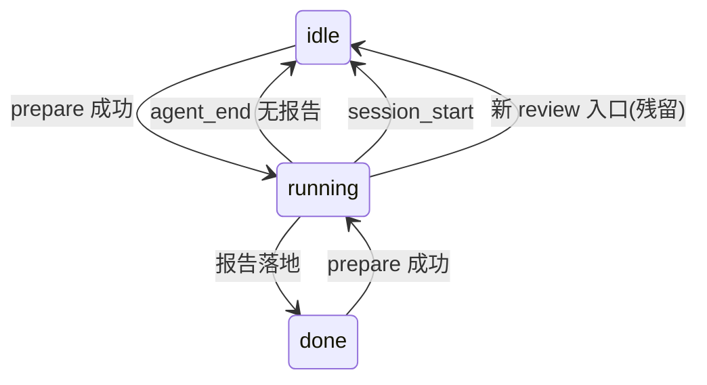

# SPEC CH — 清理与加固批（2026-11-15）

批准后落盘为 `spec/2026-11-15-cleanup-hardening.md`，同时在 spec/README 加状态行，单独提交后直接派工。

## 来源

- REVIEW-2026-11-14-review-module.md 中的 R2–R12。
- 0.5.1 发版前双轴审查（Standards 轴）发现的 6 项代码异味。
- FX-1 审查记下的 run-cmd 超时边角 N3/N4/N6。
- FX-3 审查残留的 memory 测试问题；FX-2 宿主侧残留。
- BH spec §2.2 非目标里的 P3 体验项（每项均已在 main `a4f4378` 上逐条核实，都未修）。

## 用户决策（2026-11-15）

- **D-CH-1**：本批范围为 A、B+C、D，以及 E 中的小项。E4（阻塞式 task-wait）和 E13（goal.ts / modes/index.ts 拆分）不做。
- **D-CH-2**：R11 在三处对账：`agent_end`、`session_start`、开新一轮 review 之前。
- **D-CH-3**：R12 中，PR 目标的干跑只取元数据，不克隆。
- **D-CH-4**：E1 放行 `cd`，同时让路径检查跟踪 `cd`。
- **D-CH-5**：批准后直接派工。沿用 D-BH-4：只在本地提交，不 push、不发版、不安装。

## spec 内定的默认取舍（审批时可改）

| 项 | 内定取舍 |
|---|---|
| E2 | 只在命令转后台时保留 waitFor 的「未出现」提示 |
| E3 | 只改提示文案，不改成弹出审批 |
| E5 | 状态行写任务的真实结束状态 |
| E7 | 新增 `timeout` 失败原因 |
| E10 | 保留目标文件原有的权限位 |
| E11 | ASCII 字符按 /4 计，非 ASCII 码点每个按 1 计 |
| T3 | `timeoutMs` ≤0 或非有限值表示不设上限（与 Node 惯例一致） |
| D2 | 上游提案草稿放在仓库根目录，用英文写 |

---

## A. review/ 遗留（W-R）

| ID | 设计 | 验收 |
|---|---|---|
| R2 | `target-workspace.ts:174-187` 改为：`retry.exitCode !== 0 \|\| retryHead !== expectedHeadSha` 时，先清理 root 再抛错。文案区分两种情况：重取失败，或 head 已移动。 | 先在 base 上拿到红证据：重取失败时不抛错，继续往下走。 |
| R3 | `review-run.ts:333-349` 先 `statSync`。超过 `UNTRACKED_FILE_MAX_BYTES = 1_000_000` 的文件，生成一个占位 hunk（写明大小，不放内容），并在 `diffWarning` 里追加被跳过的文件数。二进制探测只对上限内的文件读取。 | 先拿到 base 红证据（会整文件读入）。超限文件不进入 diff，并且有 warning。 |
| R4 | 删除 `workflow-schemas.ts`（零导入方），修正 docs/{en,zh}/review.md 的内部文件表。 | check 与 test 全绿。 |
| R5 | `config.ts` 头注释的路径改为 `~/.pi/agent/pi-review.json`。AGENTS 的磁盘表由 orchestrator 在台账阶段修。 | — |
| R6 | `directive.ts` 删除第二个恒定通过的 `new Function` 守卫、:65 未用的 `cwd` 解构，以及 `_LEGACY_PARITY` 导出。 | 现有套件全绿。 |
| R7 | `review-report.ts` 删除 6 处无用代码：`spawn`、`RunCmd` 导入、两处 `void`、`GhExec`、`_INTERNAL`（各自先确认零消费方）。 | 现有套件全绿。 |
| R8 | `cli-args.ts:45`：旧带值标志的下一个 token 以 `--` 开头时不吞掉它。 | `/review --diff --lite` 会设置 lite（base 上为红）。 |
| R9 | 有意设计，不改。只记 DEVIATIONS。 | — |
| R10 | `directive.ts:322-323` 改为调用 `toolBudgetForReviewer(r.id)`，让 lean-agents 成为唯一来源。 | 生成的脚本逐字节不变。 |
| R11 | 见下方状态图。 | 失败、中断、未报告三种情况：base 上状态停在 running（红），修后在 agent_end 复位为 idle。还要测：session_start 复位；新 /review 准备失败时复位残留；报告落地后仍为 done；排队中的指令不会被前一轮 agent_end 误复位。 |
| R12 | `PrepareRunInput.dryRun`：PR 目标只执行 `gh pr view` 和 `gh pr diff`，不调用 prepareWorkspace。输出写明「workspace: not cloned (dry run)」，rules 和 history 标为未计算。本地目标的输出不变。修正「side-effect free」注释，如实说明干跑会写 run 目录（由 24h 清理回收）。 | runCmd spy 证实 PR 干跑没有执行 `git clone` 或 `git fetch`（base 上为红）。 |

R11 状态流转：

R11 的实现要点：
- review 模块在闭包里记录 `liveRun`。只有在 running 发布之后、又经历过 `agent_start` 的那一轮，其 agent_end 才触发对账。
- 新 /review 入口在 `liveRun` 为空且总线是 running 时，同步复位为 idle。
- 只用现有的三个状态值，不新增总线字段。

## B. 代码异味（W-M；S5 归 W-R）

- **S1**：`bash-path-check.ts` 中重复 3 次的候选路径拼接，提取为 `checkedPaths(analysis)`。
- **S2**：把 `scanBashDeny` 公开为单次扫描函数，返回 `{deny, flagAsk}`。`modes/index.ts:1263-1274` 对每个候选只调用一次，删掉第二次的空规则扫描。用一个矩阵测试钉住决策不变：只有 deny、只有 flagAsk、两者都有、两者都没有。
- **S3**：flagAsk 改用独立类型 `BashFlagEscalation { flag }`，`BashDenyHit` 只表示路径命中。
- **S4**：`adjudicate.ts` 中 bypass 分支和步骤 3.5/3.6 重复的两个 prompt 构造块，各提取成一个 helper。
- **S6**：在 `lib/model-id.ts` 新增 `modelIdentityKey(model)`，用结构类型。`effort/index.ts` 的 `modelKey` 和 `profile-apply.ts:132` 的同模型判断都改用它。

## C. run-cmd 超时（W-R）

- **T1（N3）**：超时后先发 SIGTERM，等 `RUN_CMD_KILL_GRACE_MS = 2_000` 后发 SIGKILL。子进程退出后，如果 close 仍未到（孙进程占着管道），短暂排水后 destroy stdio 并 resolve。
  - 测试 1：忽略 SIGTERM 的子进程，配 200ms 时限，应在 4s 内返回。
  - 测试 2：孙进程占住管道，同样应在有界时间内返回。
  - 两者都先拿 base 红证据（会挂起）。
- **T2（N4）**：计时器触发时如果子进程已经退出，就按真实退出码返回，不算超时，并停止等待管道。测试命令 `sh -c 'echo hi; sleep 3 & exit 0'`，时限 500ms，应得到 exit 0 和 stdout `hi`。base 上为红（报 exit 1 和 timed out）。
- **T3（N6）**：`timeoutMs` ≤0 或非有限值时不设上限。写进头注释并加测试。
- **S5（T4）**：`CmdResult` 新增可选字段 `timedOut?: boolean`。`review-run.ts:378` 改用这个字段；stderr 里的说明文字保留给人看。模拟超时的测试 fake 补上该字段。

## D. 小尾巴

- **D1（W-B）**：给 memory 的 inFlight 守卫补一个隔离测试。先把 `turnsSinceAttempt` 调高，让节流放行，只留 inFlight 生效，证明不会重发；清掉 inFlight 后则允许重发。同时修正 `memory-v2-consolidate.test.ts:231-233` 的误导注释。
- **D2（W-M）**：起草上游提案 `UPSTREAM-2026-11-15-pi-same-model-thinking-reset.md`（英文）。
  - 先对照 node_modules 里的 pi 1.5.2 重新核实证据：`model-selector.js:123-125`、`:372-375`，`interactive-mode.js:4591-4605`，以及 `agent-session` 的 setModel 和 `_emitModelSelect`。
  - 提出两个方案：同模型时跳过重置；或者在 modelsAreEqual 时也发出 `model_select`。
  - 不对外提交。

## E. BH P3 小项

| ID | 负责 | 设计 | 验收 |
|---|---|---|---|
| E1 | W-M | `bash-analysis.ts` 放行三类写法。① `N>/dev/null`、`&>/dev/null`、`>>/dev/null`（精确匹配 `/dev/null`）。② `git` 后跟一个或多个字面路径的 `-C <路径>`，然后接安全子命令。③ `&&` 链里的字面 `cd <目录>`。`bash-path-check` 沿 `&&` 链跟踪字面 cd，后续各段的相对路径按 cd 后的目录解析（W3、W4、P1-4、flag 检查全部适用）。cd 后接 `;`、`\|\|`、管道或子 shell，或者目录不是字面量（`$`、`` ` ``、`~`、`-`、无参数）时，整条命令不算 safe，路径解析保持现状。 | 正例：回测里那 5 种被拦命令全部通过。反例：`cd x && rm y`、`cd $(…)`、`cd ~`、`cd a; ls`、`git -c k=v log`、`>/dev/nullx`、`2>/dev/null >out` 都不算 safe。W4 正例：配 `Read(./.env)` 时，`cd sub && cat ../.env` 被拒（base 上为红）。auto 第一层、plan 门禁、modes 套件全绿。 |
| E2 | W-B | waitFor 的参数说明加上「不等待时省略」。「never appeared」提示只在转后台的那条路径保留，正常退出和报错两条路径都去掉。 | 更新 `foreground.test.ts:683-706` 的固定用例，并补齐这三条路径的用例。 |
| E3 | W-M | `auto-engine.ts:213` 直接返回 `buildClassifierUnavailableMessage` 的文案，不再外包 YOLO 拒绝消息。 | 文案里不再有「Permission … denied」和规则提示（base 上为红）。 |
| E5 | W-B | `registry.ts:388-394`：任务已结束时，如果完成状态行已经追加过（`notified` 已为 true），就不再追加；否则追加一行，写真实结束状态和 exitCode，不写 `killed`。先在 contracts README 更新 BG-ENTRY-03 行的措辞，数据形状不变。 | exit 0 的任务被 TaskStop 后，状态行不是 killed（base 上为红）。不会出现重复行。 |
| E6 | W-B | `session_start` 时，用当前分支里 `cc-core-bg-shell-task` 条目的最大编号来抬高 `nextId`（只增不减）。 | 模拟新进程且日志已清理：base 上分配到 bg-1（红），修后为最大编号加一。 |
| E7 | W-B | `memory/llm.ts`：区分内部计时器触发和外部 abort，新增 `timeout` 原因。逐个审查所有按 `"aborted"` 分支的消费方：外部 abort 的行为不变，timeout 需要逐处说明怎么处理。不新增设置键。 | 两种原因分别有测试；`/memory` 诊断能显示 timeout。 |
| E8a | W-M | 删除空转的 `ensureLocalPermissionsGitignored` 及其调用点。`warnIfLocalPermissionsNotGitignored` 改用 `git check-ignore -q`；git 不可用时退回原来的逐行匹配。删除无消费方的 `isClassifierDenial`。 | `.pi/` 这类模式不再误报（base 上为红）。 |
| E8b | W-B | 删除 `check.mjs` 里的 `GOAL_DRIFTS` 死分支。 | `check` 通过。 |
| E9 | W-B | `run-tests.mjs` 改为用 readdirSync 枚举测试文件，再用 execFileSync 调用本地 `tsx` / `vitest` 二进制，不再写死 zsh。 | 改动前后各框架的用例数一致；任一套件失败时仍以 exit 1 退出（自证后撤掉验证改动）。 |
| E10 | W-B | `lib/settings.ts` 的 `writeJsonAtomic`：没传 mode 且目标文件已存在时，把原文件的 `mode & 0o777` 复制到临时文件，再 rename。显式传 mode 时以传入值为准。 | 0600 文件写入后仍为 0600（base 上为红）；新建文件仍走 umask。 |
| E11 | W-B | `observation.ts` 的 `estimateTokens` 改为 `ceil(ascii/4 + 非ASCII码点数)`。ASCII 文本的结果与原来一致。 | `"中文测试"` 得 4（base 上为 1）；原有 `"abcd"`=1 的用例保持；金丝雀为绿。 |
| E12 | W-R | 把各审查者共用的提示行在 workflow 脚本里只生成一次。新增常量 `REVIEW_DIRECTIVE_MAX_CHARS`，取值为去重后实测长度再留约 10% 余量。 | 先后各量一次默认全员 directive 的长度并上报数字。用 fake `runs` 执行生成的脚本，证明每个审查者最终拿到的 prompt 逐字节不变。再加一条测试，钉住 directive 长度不超过该常量。 |

## 非目标

- E4、E13；R9 不改；E3 的改弹审批方案不做。
- 非 `&&` 形式的 cd 路径追踪不做，记为已知残留。
- 不新增环境变量或设置键（INV-10）。
- 不改 session entry 和磁盘布局（P0-CT-08/09），不改 contracts 测试的期望（只更新 README 里 BG-ENTRY-03 的措辞）。
- SC 长期复测、H-SC 真机验收不在本批。
- `lib/` 只允许改 `settings.ts` 与 `model-id.ts`。

## 派工与收尾

| worker | 项 | 文件归属 |
|---|---|---|
| W-R | R2–R12、T1–T4、E12 | `extensions/review/**`、`test/lib/review-*.test.ts`、docs/{en,zh}/review.md |
| W-M | S1–S4、S6、E1、E3、E8a、D2 | `extensions/modes/**`、`extensions/effort/index.ts`、`lib/model-id.ts`、docs 中 modes / effort 两份文档、UPSTREAM 草稿 |
| W-B | E2、E5–E7、E8b–E11、D1 | `extensions/{bg-shell,observation-pack,memory}/**`、`lib/settings.ts`、`scripts/`、`test/lib/{memory-*,settings}.test.ts`、contracts README 的 BG-ENTRY-03 行，以及对应模块文档 |

- **准备**：在 spec 提交上为每个 worker 建独立 worktree，并各自执行 `pnpm install`。
- **纪律**：bug 修复都要先在 base 上拿到失败证据。纯重构不改现有断言。
- **worker 边界**：不改 CHANGELOG、DEVIATIONS、PROGRESS 或 spec/README，只在最终报告里附台账草稿。
- **审查**：每个分支独立做只读审查。子 agent 报 `model_provider_unavailable` 时，带上下文 resume 重派。
- **合入**：顺序为 W-B → W-M → W-R，rebase + ff，保持线性历史。合入后在 main 上跑 `bun run check`、`test`、`contracts` 和金丝雀，期望零失败，并记录各框架的用例数。
- **台账（orchestrator）**：
  - CHANGELOG 新增 `## Unreleased`；
  - DEVIATIONS 新增「清理加固批（SPEC CH）」节，记入 R9 有意设计、E1 残留、FX-2 上游草稿；
  - PROGRESS 同日节；spec/README 状态行；
  - 按 R5 修正 AGENTS.md / AGENTS.zh.md 磁盘表中的 review 行，`pi-review.json` 实际位于 `~/.pi/agent/`。
- **收尾**：删除 worktree 和临时分支。只在本地提交。
